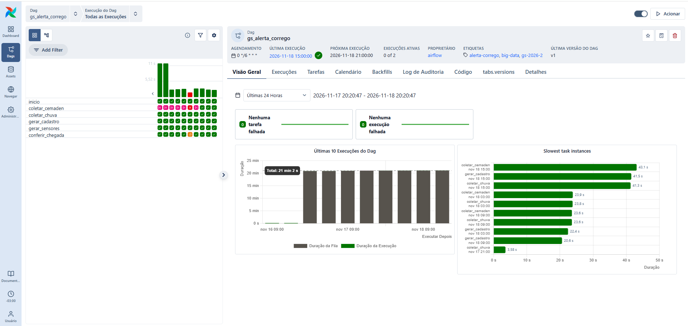

# Alerta Córrego

> Global Solution 2026.2 — FIAP, Engenharia de Software, 4º ano  
> Disciplina: **Big Data**

## Integrantes

- João Pedro de Albuquerque Oliveira | 551579
- Pedro Augusto Carneiro Barone Bomfim | 99781
- Matheus Augusto Santos Rego | 551466

## Sobre o projeto

O **Alerta Córrego** é um protótipo acadêmico de Big Data para integrar informações de precipitação, monitoramento hidrometeorológico e medições simuladas de nível de córregos em regiões de São Paulo. O projeto demonstra a coleta orquestrada de dados, sua transformação em camadas analíticas e consultas para explorar condições associadas a possíveis situações de risco.

> **Importante:** as leituras dos sensores, os cadastros de moradores e os limites de risco são **sintéticos ou ilustrativos**. O projeto não emite alertas oficiais, não prevê enchentes de forma validada e não deve ser usado para decisões de segurança pública.

## Tecnologias

- **Python:** coleta e geração de dados.
- **Apache Airflow:** orquestração da DAG e execução programada.
- **Databricks e PySpark:** ingestão e transformação de dados.
- **Delta Lake:** armazenamento das tabelas analíticas.
- **Databricks SQL:** consultas e análises.
- **Git e GitHub:** versionamento e documentação.

## Fontes de dados

| Fonte | Conteúdo | Natureza |
|---|---|---|
| Open-Meteo | Precipitação | Fonte meteorológica externa |
| CEMADEN | Dados de estações de monitoramento | Fonte externa |
| Sensores de córregos | Nível da água | Dados sintéticos |
| Cadastro de moradores | Pessoas vinculadas aos pontos monitorados | Dados sintéticos |

Os arquivos JSON são produzidos localmente em subpastas de `chegada/`, organizadas por fonte. Os dados operacionais e os lotes temporários não são versionados neste repositório.

## Arquitetura do pipeline

```text
Open-Meteo ──────────────┐
CEMADEN ─────────────────┤
Sensores sintéticos ─────┼──> Apache Airflow ──> chegada/*.json
Cadastros sintéticos ────┘                              │
                                                       ▼
                                             Databricks Volume
                                                       │
                                                       ▼
                                               BRONZE (ingestão)
                                                       │
                                                       ▼
                                          SILVER (tratamento)
                                                       │
                                                       ▼
                                         GOLD (modelo dimensional)
                                                       │
                                                       ▼
                                             Consultas analíticas
```

### 1. Orquestração — Airflow

A DAG **`gs_alerta_corrego`** organiza as etapas de coleta de chuva e dados do CEMADEN, geração de medições sintéticas e cadastros, e conferência dos arquivos produzidos.

Agendamento configurado: **`0 */6 * * *`** (a cada seis horas).

### 2. Bronze — Ingestão

O arquivo [`databricks/01_bronze.py`](databricks/01_bronze.py) implementa a ingestão incremental dos arquivos JSON no Databricks.

Tabelas geradas:

- `workspace.gs.bronze_chuva`
- `workspace.gs.bronze_cemaden`
- `workspace.gs.bronze_sensor`
- `workspace.gs.bronze_cadastro`

A ingestão foi demonstrada em dois lotes sucessivos, permitindo verificar o processamento incremental.

### 3. Silver — Tratamento e qualidade

O arquivo [`databricks/02_prata.py`](databricks/02_prata.py) prepara os dados para análise, com padronização, verificações de qualidade e tratamento de duplicidades.

Tabelas geradas:

- `workspace.gs.prata_chuva_hora`
- `workspace.gs.prata_nivel_corrego`
- `workspace.gs.prata_cemaden_estacao`
- `workspace.gs_restrito.prata_morador`

A tabela de moradores é armazenada em um esquema separado (`gs_restrito`). O acesso efetivo depende das permissões configuradas no Databricks; a separação por esquema, isoladamente, não garante controle de acesso.

### 4. Gold — Modelo dimensional

O arquivo [`databricks/03_ouro.py`](databricks/03_ouro.py) cria as tabelas analíticas:

| Tabela | Descrição |
|---|---|
| `workspace.gs.ouro_dim_ponto` | Dimensão dos pontos monitorados |
| `workspace.gs.ouro_dim_tempo` | Dimensão temporal |
| `workspace.gs.ouro_fato_monitoramento` | Medições de nível relacionadas à precipitação horária |

A associação de chuva e sensor considera o ponto monitorado e a hora da medição. A precipitação horária pode, portanto, aparecer repetida em diferentes leituras do mesmo intervalo; nas consultas horárias, usa-se `MAX(precip_mm)` para evitar somas indevidas.

## Resultados validados

Contagens observadas durante os testes no Databricks:

| Camada | Tabela | Registros |
|---|---|---:|
| Bronze | `bronze_chuva` | 36 |
| Bronze | `bronze_cemaden` | 4 |
| Bronze | `bronze_sensor` | 36 |
| Bronze | `bronze_cadastro` | 36 |
| Silver | `prata_chuva_hora` | 1.152 |
| Silver | `prata_nivel_corrego` | 5.064 |
| Silver | `prata_cemaden_estacao` | 135 |
| Silver | `prata_morador` | 702 |
| Gold | `ouro_dim_ponto` | 4 |
| Gold | `ouro_dim_tempo` | 1.296 |
| Gold | `ouro_fato_monitoramento` | 5.064 |

Os resultados correspondem à execução documentada e podem variar em novas ingestões. Os números não representam ocorrências reais de enchente.

## Consultas analíticas

As cinco consultas estão reunidas em [`databricks/04_consultas.sql`](databricks/04_consultas.sql):

1. **Monitoramento por região:** contagem de medições, médias e máximos de nível e precipitação.
2. **Evolução diária:** média e máximo do nível da água por dia e ponto.
3. **Chuva × nível:** análise por hora, destacando períodos com maior precipitação.
4. **Classificação de risco:** distribuição das medições por faixas ilustrativas.
5. **Impacto potencial:** contagem agregada de moradores sintéticos com consentimento, por ponto e risco máximo observado, sem exibir nomes ou telefones.

### Faixas ilustrativas de risco

| Categoria | Nível da água |
|---|---|
| BAIXO | Menor que 40 cm |
| ATENCAO | De 40 cm a menos de 55 cm |
| ALERTA | De 55 cm a menos de 70 cm |
| CRITICO | 70 cm ou mais |

**Esses limites não são oficiais** e servem apenas à demonstração acadêmica. A quantidade de moradores cadastrados em uma região não equivale à quantidade de pessoas efetivamente afetadas.

## Evidências de execução

### Airflow



### Contagens das tabelas no Databricks

- [Camada Bronze](evidencias/databricks/bronze_contagens.png)
- [Camada Silver](evidencias/databricks/silver_contagens.png)
- [Camada Gold](evidencias/databricks/gold_contagens.png)

### Resultados das cinco consultas

- [Consulta 1 — Monitoramento por região](evidencias/consultas/consulta_01_monitoramento.png)
- [Consulta 2 — Evolução diária](evidencias/consultas/consulta_02_evolucao_diaria.png)
- [Consulta 3 — Relação entre chuva e nível](evidencias/consultas/consulta_03_chuva_nivel.png)
- [Consulta 4 — Classificação de risco](evidencias/consultas/consulta_04_classificacao_risco.png)
- [Consulta 5 — Impacto potencial](evidencias/consultas/consulta_05_impacto_moradores.png)

## Estrutura do repositório

```text
gs-big-data/
├── dags/                    # Código da DAG do Airflow
├── databricks/
│   ├── 01_bronze.py
│   ├── 02_prata.py
│   ├── 03_ouro.py
│   └── 04_consultas.sql
├── evidencias/
│   ├── airflow/
│   ├── databricks/
│   └── consultas/
├── ambiente.sh
├── .gitignore
└── README.md
```

## Como reproduzir

1. Preparar um ambiente Python com as dependências necessárias para a DAG e configurar o Apache Airflow.
2. Configurar a variável `CHEGADA_DIR` com o caminho absoluto da pasta local `chegada/`.
3. Configurar a fonte CEMADEN com o endpoint validado no ambiente, quando necessário.
4. Executar a DAG `gs_alerta_corrego` e verificar os arquivos JSON produzidos.
5. Disponibilizar os JSONs no Volume do Databricks utilizado pelo projeto (`/Volumes/workspace/gs/chegada`).
6. Executar, nessa ordem, `01_bronze.py`, `02_prata.py` e `03_ouro.py` no Databricks, ajustando configurações e permissões conforme o workspace.
7. Executar as consultas de `04_consultas.sql` no Databricks SQL Editor e comparar os resultados com as evidências.

> O repositório contém o código e as evidências, mas não inclui os arquivos de dados operacionais nem a configuração integral do ambiente. A reprodução exige preparar as dependências, os recursos e as permissões correspondentes.

## Limitações e uso responsável

- O protótipo não é um sistema operacional de alerta ou previsão hidrológica.
- As medições dos sensores e os cadastros de moradores são sintéticos.
- As faixas de risco são demonstrativas e não foram calibradas com referências oficiais.
- O indicador de moradores potencialmente impactados não mede pessoas realmente afetadas.
- Dados pessoais devem permanecer protegidos por permissões adequadas; as consultas publicadas apresentam apenas agregados.
- Qualquer aplicação real exigiria validação de dados, calibração, monitoramento, governança e integração com os órgãos responsáveis.
